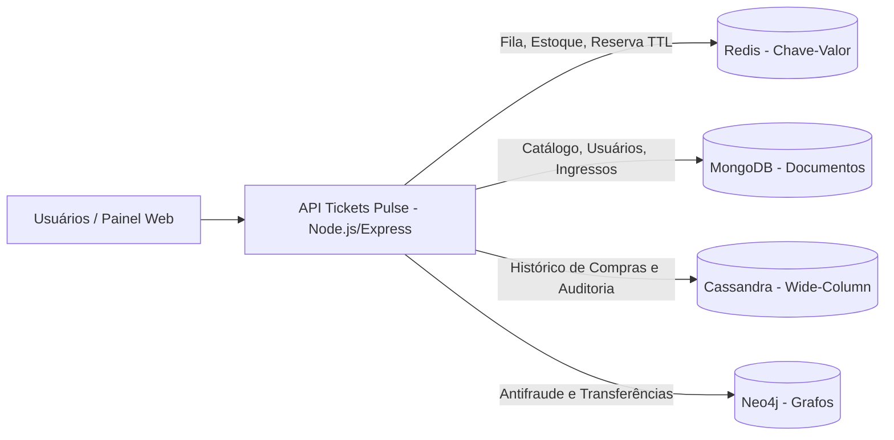

# Tickets Pulse — Documentação Final (Marco 2)

**Disciplina:** Bancos de Dados NoSQL: Persistência e Distribuição de Big Data (CEUB)  
**Alunos:** Leonardo Soares Paes e Victor Zainote  

---

## 1. Evolução do Marco 1 para o Marco 2

No **Marco 1**, o grupo modelou a camada crítica de concorrência do **Tickets Pulse** (plataforma distribuída de venda de ingressos e filas virtuais para eventos de grande porte, com picos de 100 mil usuários disputando 50 mil ingressos e 15 mil+ req/s) utilizando duas famílias NoSQL:
- **Chave-Valor (Redis):** fila virtual (`ZADD`/`ZRANK`), reserva temporária com TTL (`HSET`/`EXPIRE`) e controle atômico de estoque (`DECRBY`).
- **Wide-Column (Cassandra):** histórico durável de compras por evento (`compras_por_evento`) com modelagem *query-first*.

No **Marco 2**, o sistema evolui para uma **arquitetura de persistência poliglota completa**, integrando as **quatro famílias NoSQL** da disciplina em um sistema funcional com API e painel web de demonstração:
- **Documentos (MongoDB):** catálogo de eventos com estrutura variável (setores, lotes, regras), perfis de usuários e ingressos emitidos com histórico de transferências.
- **Grafos (Neo4j):** análise de relacionamentos para detecção de fraude/cambismo (múltiplas contas compartilhando dispositivo ou cartão) e rastreamento de repasses de ingressos.

---

## 2. Arquitetura Poliglota



### Fluxo completo da compra (Ciclo de Vida)
1. **Descoberta:** a API lê o catálogo semiestruturado no **MongoDB** (`eventos`) e o saldo em tempo real no **Redis** (`estoque:<evento>:<setor>`).
2. **Fila Virtual:** o usuário entra na fila via `ZADD` no **Redis** (`Sorted Set`), consultando sua posição em $O(\log N)$ via `ZRANK`.
3. **Reserva com TTL:** ao ser liberado, a API executa `DECRBY` atômico no estoque, cria um `Hash` (`reserva:<usuarioId>`) com `EXPIRE` de 600s e registra auditoria no **Cassandra**. Se o TTL expirar sem pagamento, o worker devolve os ingressos ao estoque (`INCRBY`).
4. **Checkout Poliglota:** confirmado o pagamento:
   - **Cassandra:** grava o registro definitivo em `compras_por_evento`.
   - **MongoDB:** emite os documentos individuais em `ingressos` com QR Code e metadados.
   - **Neo4j:** cria/atualiza nós `Usuario`, `Evento`, `Dispositivo`, `Cartao` e arestas `COMPROU`, `USOU_DISPOSITIVO`, `PAGOU_COM`.
   - **Redis:** remove a chave temporária `reserva:<usuarioId>`.
5. **Transferência e Antifraude:** transferências atualizam o documento no **MongoDB** (`$set` + `$push` no histórico) e adicionam a aresta `TRANSFERIU_PARA` no **Neo4j**, permitindo identificar cambistas e cadeias de repasse em poucos saltos.

---

## 3. Modelagem de Dados por Família

### 3.1 Chave-Valor (Redis)
- `fila:<eventoId>` (**Sorted Set**): score = timestamp de entrada; membro = `usuario:<id>`. Comandos: `ZADD`, `ZRANK`, `ZREM`.
- `estoque:<eventoId>:<setor>` (**String/Counter**): saldo disponível decrementado atomicamente com `DECRBY` e estornado com `INCRBY`.
- `reserva:<usuarioId>` (**Hash + TTL**): campos `eventoId`, `setor`, `qtd`, `status`, com `EXPIRE 600`.

### 3.2 Documentos (MongoDB)
Coleções em JSON/BSON com esquema flexível (cada evento pode ter setores, lotes e regras diferentes sem `ALTER TABLE`):
- `eventos`: `{ _id, nome, local, data, categoria, setores: [{ codigo, nome, preco, capacidade }], metadados: { ... } }`
- `usuarios`: `{ _id, nome, email, cpf_mask }`
- `ingressos`: `{ _id, compra_id, evento_id, setor, valor, titular_id, status, qr_code, historico_transferencias: [...] }`

### 3.3 Wide-Column (Cassandra — Query-First)
Modelagem orientada às consultas principais (`db/cassandra-init.cql`):
```sql
CREATE TABLE compras_por_evento (
  evento_id text,
  comprado_em timestamp,
  compra_id uuid,
  usuario_id text,
  setor text,
  quantidade int,
  valor_total decimal,
  status text,
  PRIMARY KEY ((evento_id), comprado_em, compra_id)
) WITH CLUSTERING ORDER BY (comprado_em DESC);
```
- **Partition Key (`evento_id`):** distribui os dados de cada evento pelos nós do cluster.
- **Clustering Column (`comprado_em DESC`):** ordena fisicamente em disco do mais recente para o mais antigo.

### 3.4 Grafos (Neo4j — Cypher)
- **Nós:** `Usuario`, `Evento`, `Dispositivo`, `Cartao`.
- **Arestas:** `(:Usuario)-[:USOU_DISPOSITIVO]->(:Dispositivo)`, `(:Usuario)-[:PAGOU_COM]->(:Cartao)`, `(:Usuario)-[:COMPROU {qtd}]->(:Evento)`, `(:Usuario)-[:TRANSFERIU_PARA]->(:Usuario)`.
- **Consulta antifraude (detecção de cambismo):**
```cypher
MATCH (u:Usuario)-[:USOU_DISPOSITIVO]->(d:Dispositivo)
WITH d, collect(DISTINCT u.id) AS usuarios
WHERE size(usuarios) > 1
RETURN 'Dispositivo' AS tipo, d.id AS recurso, usuarios;
```

---

## 4. Fundamentos de Sistemas Distribuídos e Justificativas

1. **Limites do Relacional:** em aberturas de vendas, milhares de `UPDATE` simultâneos na mesma linha de estoque geram contenção de *locks*, serialização de transações, timeouts e *deadlocks*. Além disso, escalar escrita horizontalmente e fazer `JOIN` recursivo para detectar fraudes em múltiplos saltos é custoso no modelo relacional.
2. **Teorema CAP por Operação:**
   - **Fila virtual e catálogo (AP):** priorizam disponibilidade e baixa latência; atrasos momentâneos entre réplicas são aceitáveis.
   - **Estoque e checkout (CP / Consistência ajustável):** decremento atômico no Redis e confirmação durável no Cassandra (com *consistency level* configurável por operação, ex.: `QUORUM`).
3. **ACID vs. BASE:**
   - **BASE:** fila virtual e reservas com TTL (*Soft State* — expiram automaticamente) e histórico analítico/auditoria (*Eventually Consistent*).
   - **Atomicidade pontual:** `DECRBY` no Redis evita *overselling* sem *locks* distribuídos pesados.
4. **Sharding e Replicação:**
   - **Redis:** *Consistent Hashing* (Redis Cluster por *hash slots*) para distribuir chaves de eventos/usuários e replicação *Master-Slave* (réplicas de leitura + failover).
   - **Cassandra:** particionamento por *Consistent Hashing* da `evento_id` no anel, com fator de replicação configurável (`replication_factor = 3`) e arquitetura *Masterless* (sem ponto único de falha).
   - **MongoDB:** *Sharding* por `evento_id` / `_id` com *Replica Sets* (Primary + Secondaries).
   - **Neo4j:** cluster causal com *Leader* para escritas e *Read Replicas* para consultas de grafos antifraude.
